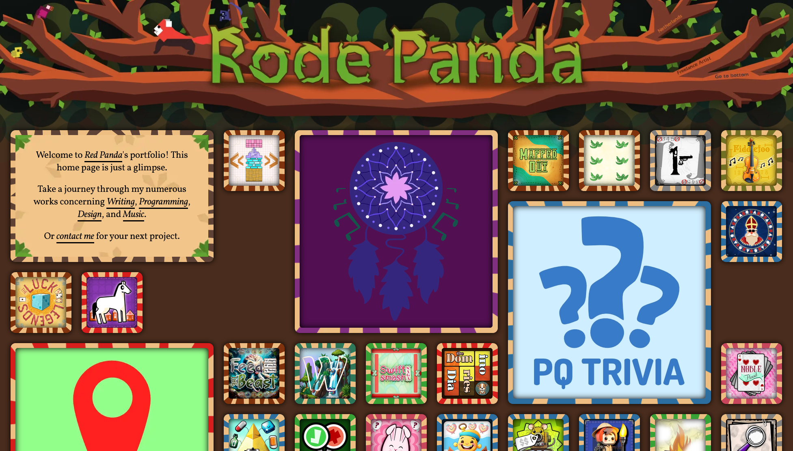

# Rode Panda

This is the full source code / project behind [Rode Panda (my Portfolio)](https://rodepanda.com).

## What Is It?

The website contains pages on **all projects I made until ~2025**. Each page,

* Has an image and description (Dutch and English)
* Links to the project's actual active page (this is just a portfolio)
* Links to the project's source code/assets (if possible)
* Links to any bonus content that might interest people (devlogs, older versions, etcetera)

The website lists all projects in a nice grid and has strong search functionality to find what you want.

_Why does it not contain most project post 2025?_ It's complicated. The portfolio was a nice way to showcase my work and bring it all together in one place _when I did not have a better place_. But now I have my large online store, my music/books/games are published/sold on proper platforms, and the list of things I made is just too big anyway.

The portfolio is still a nice landing page for my company here in the Netherlands. But it likely won't be updated and might disappear in the future.

## Project Structure

It's made using Hugo. That means it's a static website that rebuilds automatically whenever this repository is updated.

The actual website is inside `rode-panda`. Everything else is metadata or supportive documents for the project.

Nothing is hidden or changed for this public version. It's the actual website, as I build it and host it. You might even find as of yet unpublished stuff there.

The website is multilingual: Dutch (`nl` folder) and English (`en` folder).

I'm open sourcing all my websites in an effort towards an open world based on sharing and transparency. It's the least I can do.